# 🚨 Awesome-Incident-Management-Alerting

 

### ⚡ Top Incident Management & Alerting Ecosystem

**A Curated Directory of SaaS Solutions & Open-Source Projects for SREs, DevOps, and Operations Engineers**  
*Master On-Call Scheduling, Intelligent Alert Routing, AIOps Event Correlation, and Self-Hosted Incident Response*

**Last updated: November 2026**

---

## 📌 Table of Contents

- [🌐 Sector Overview & Market Dynamics](#-sector-overview--market-dynamics)
- [🏢 SaaS & Hosted Platforms](#-saas--hosted-platforms)
- [💻 Open-Source GitHub Projects](#-open-source-github-projects)
  - [⭐ Open-Source Solutions Ranked by GitHub Stars](#-open-source-solutions-ranked-by-github-stars)
  - [Detailed Breakdown by Category](#-detailed-breakdown-by-category)
- [🤝 How to Contribute](#-how-to-contribute)
- [⚠️ Disclaimer](#-disclaimer)

---

## 🌐 Sector Overview & Market Dynamics

The global **Incident and Emergency Management market** is valued at approximately **$135 billion in 2024–2025 and is projected to exceed $220 billion by 2030 (CAGR ~8.5–10%)**, with the dedicated IT Incident Management, AIOps, and On-Call Alerting software segment accounting for **$3.5 billion to $5.5 billion** and growing rapidly.

The sector exhibits **moderate fragmentation with high concentration around core alerting hubs**: public giants like **PagerDuty**, **Datadog**, and **Atlassian (Opsgenie)** dominate mission-critical enterprise paging, while agile challengers (**incident.io**, **Better Stack**, and **Rootly**) rapidly capture high-velocity engineering organizations through Slack/Teams-native coordination and automated post-mortems.

---

## 🏢 SaaS & Hosted Platforms

| Rank | Platform | Company Scale (Revenue / Valuation) | Starting Pricing (Specific Tier) | Free Tier / Trial Limit | Key Focus & Strengths |
| :--- | :--- | :--- | :--- | :--- | :--- |
| 1 | **[Datadog Incident Management](https://www.datadoghq.com/)** | **~$2.68B ARR** (Market Cap: ~$40B+) | **$20 per incident commander / month** (or Pro observability tier starting at $15/host/mo) | **14-day free trial** with full platform capabilities and unlimited host metrics access | End-to-end incident coordination fully unified with APM, metrics, traces, and automated telemetry correlation. |
| 2 | **[VictorOps (Splunk On-Call)](https://www.splunk.com/)** | **~$4.2B ARR** (Acquired by Cisco for $28B) | **$5 per user / month** (Starter plan; Growth tier at $23/user/mo) | **14-day free trial** including alert rules, schedules, and escalation workflows | Purpose-built for IT operations and SREs requiring enterprise-grade Splunk observability linkage and runbooks. |
| 3 | **[Opsgenie](https://www.atlassian.com/software/opsgenie)** (Atlassian) | **~$4.4B ARR** (Parent Atlassian Market Cap: ~$50B+) | **$9 per user / month** (Essentials plan; Standard tier at $19/user/mo) | **Free forever plan for up to 5 users** (includes 100 SMS/voice alerts/month, basic schedules, and mobile apps) | Seamless bidirectional sync with Jira Software, Jira Service Management, Confluence, and Atlassian tooling. |
| 4 | **[PagerDuty](https://www.pagerduty.com/)** | **~$450M ARR** (Market Cap: ~$1.8B+) | **$21 per user / month** billed annually (Professional plan; Business tier at $41/user/mo) | **Free forever plan for up to 5 users** (basic schedules, unlimited push notifications, email alerts, REST API) | Industry-standard on-call paging, multi-tiered escalation chains, live call routing, and over 700+ turnkey integrations. |
| 5 | **[BigPanda](https://www.bigpanda.io/)** | **~$90M ARR** ($1.2B+ Unicorn Valuation) | **$18 per user / month** (Standard platform subscription; enterprise custom volume commits) | **30-day free trial** with full OpenBox machine learning event deduplication and correlation engine | Enterprise AIOps engine that ingests high-volume noise, clusters correlated events, and prevents alert fatigue. |
| 6 | **[Better Stack](https://betterstack.com/)** | **~$35M ARR** ($500M+ Valuation) | **$25 per team / month** (Freelancer plan includes 5 team members; Small Team at $85/mo) | **Free forever plan** (10 monitors, 3-minute checks, 5 phone calls/SMS, status page with custom domain) | Modern, developer-beloved incident response with built-in uptime monitoring, synthetic checks, and slick status pages. |
| 7 | **[incident.io](https://incident.io/)** | **~$20M ARR** ($350M+ Valuation) | **$19 per user / month** billed annually (Starter plan; Pro plan at $49/user/mo) | **14-day free trial** with unlimited Slack-native incident rooms, status pages, and catalog sync | Slack-native and Teams-native command center automating channel creation, executive updates, and auto-generated retrospectives. |
| 8 | **[Rootly](https://rootly.com/)** | **~$15M ARR** ($200M+ Valuation) | **$16 per user / month** billed annually (Starter tier; Pro tier at $39/user/mo) | **14-day free trial** with full access to Slack workflows, post-mortem templates, and on-call paging | Automates incident management right inside Slack and Zoom; automated timelines, action-item tracking, and GenAI summaries. |
| 9 | **[Squadcast](https://www.squadcast.com/)** | **~$10M ARR** ($80M+ Valuation) | **$9 per user / month** billed annually (Pro plan; Enterprise tier at $19/user/mo) | **Free forever plan for up to 5 users** (unlimited incidents, on-call schedules, push notifications, 10 SMS/user/mo) | Cloud-native SRE incident platform featuring Intelligent Alert Grouping, live conference calling, and escalation policies. |

---

## 💻 Open-Source GitHub Projects

### ⭐ Open-Source Solutions Ranked by GitHub Stars

| Rank | Project | GitHub Stars Badge | License | Language | Primary Category |
| :---: | :--- | :--- | :--- | :--- | :--- |
| 1 | **[Uptime Kuma](https://github.com/louislam/uptime-kuma)** |  | AGPL-3.0 | JavaScript / Node.js | Self-hosted monitoring & incident alerting status pages |
| 2 | **[Netdata](https://github.com/netdata/netdata)** |  | GPL-3.0 | C / Go / Python | Real-time infrastructure health & anomaly alerting engine |
| 3 | **[Sentry](https://github.com/getsentry/sentry)** |  | FSL-1.1-Apache-2.0 | Python / TypeScript | Application error tracking & performance incident triage |
| 4 | **[SigNoz](https://github.com/signoz/signoz)** |  | Apache-2.0 | Go / TypeScript | OpenTelemetry observability, metric thresholds & alert triggers |
| 5 | **[OpenObserve](https://github.com/openobserve/openobserve)** |  | AGPL-3.0 | Rust / Vue | High-performance log/trace stream monitoring and alerting |
| 6 | **[Upptime](https://github.com/upptime/upptime)** |  | MIT | TypeScript / Action | GitHub Actions powered uptime monitor and automated incident alerts |
| 7 | **[Keep](https://github.com/keephq/keep)** |  | Apache-2.0 | Python / TypeScript | Open-source AIOps platform & alert deduplication engine |
| 8 | **[Prometheus Alertmanager](https://github.com/prometheus/alertmanager)** |  | Apache-2.0 | Go | Prometheus alerting routing, deduplication, grouping & silencing |
| 9 | **[OneUptime](https://github.com/OneUptime/oneuptime)** |  | Apache-2.0 | TypeScript | All-in-one on-call scheduling, status page & incident suite |
| 10 | **[StackStorm](https://github.com/StackStorm/st2)** |  | Apache-2.0 | Python | Event-driven ChatOps & automated remediation engine |
| 11 | **[Dispatch](https://github.com/Netflix/dispatch)** |  | Apache-2.0 | Python / Vue | Netflix incident orchestrator (Slack, Jira, Google Docs, Zoom) |
| 12 | **[TheHive](https://github.com/TheHive-Project/TheHive)** |  | AGPL-3.0 | Scala | Security incident response (SOC), case management & task tracking |
| 13 | **[Grafana OnCall OSS](https://github.com/grafana/oncall)** |  | AGPL-3.0 *(Archived)* | Python / TypeScript | On-call management *(Read-only archive since March 2026)* |
| 14 | **[GoAlert](https://github.com/target/goalert)** |  | Apache-2.0 | Go | Enterprise-grade on-call scheduling, SMS/voice paging (Target OSS) |
| 15 | **[Alerta](https://github.com/alerta/alerta)** |  | Apache-2.0 | Python | Flexible alert consolidation, deduplication & visual dashboard |
| 16 | **[emu-oncall](https://github.com/ebogdanov/emu-oncall)** |  | MIT | Go | Headless on-premise Grafana OnCall API compatibility & SMS engine |

---

### 🔍 Detailed Breakdown by Category

#### 📞 1. On-Call Scheduling & Notification Escalation

- 🎯 **[GoAlert](https://github.com/target/goalert)**   
  Target's battle-tested self-hosted PagerDuty alternative distributed as a single Go binary. Features robust rotation schedules, automated escalation policies, phone call/SMS paging via Twilio, and Slack alerts with no user seats licensing fees.

- ⚙️ **[emu-oncall](https://github.com/ebogdanov/emu-oncall)**   
  A lightweight Go REST API backend compatible with Grafana OnCall on-premise installations, facilitating custom SMS gateways, VoIP routing, and iCal calendar schedule sync.

#### 🤖 2. Alert Routing, Deduplication & AIOps Noise Reduction

- 🧠 **[Keep](https://github.com/keephq/keep)**   
  The leading open-source AIOps and alert correlation framework (acquired by Elastic in 2025, developed as open-source). Ingests alerts from all monitoring tools, removes duplicates, runs YAML workflow automations, and provides AI incident summaries.

- 🔀 **[Prometheus Alertmanager](https://github.com/prometheus/alertmanager)**   
  The gold standard cloud-native alert engine handling alert de-duplication, grouping, silencing, and multi-channel routing to Slack, PagerDuty, email, and webhooks.

- 📊 **[Alerta](https://github.com/alerta/alerta)**   
  A scalable alert console and API that correlates alerts from Prometheus, Nagios, Sensu, and custom scripts into unified operational views with automated status transitions.

#### 🚀 3. Full-Lifecycle Incident Orchestration & Response

- 🛡️ **[Netflix Dispatch](https://github.com/Netflix/dispatch)**   
  Netflix's crisis-management orchestrator. When an incident triggers, Dispatch automatically provisions dedicated Slack channels, spins up Zoom conference bridges, creates Google Drive post-mortem docs, tracks participants, and writes timeline events.

- 🌐 **[OneUptime](https://github.com/OneUptime/oneuptime)**   
  A complete open-source alternative to Datadog and PagerDuty, consolidating uptime monitoring, incident management, on-call paging, status pages, and telemetry under a single codebase.

- 🕵️ **[TheHive](https://github.com/TheHive-Project/TheHive)**   
  A security incident response and case management platform designed for SOC analysts and CERT teams to investigate threats collaboratively with MISP and Cortex integrations.

#### 📈 4. Uptime Monitoring & Real-Time Alert Triggering

- ⏱️ **[Uptime Kuma](https://github.com/louislam/uptime-kuma)**   
  A self-hosted monitoring tool offering HTTP(s), TCP, Ping, DNS, and Docker container checks with 90+ alert notification services (Telegram, Discord, Slack, Email, Pushover) and public status pages.

- ⚡ **[Netdata](https://github.com/netdata/netdata)**   
  Distributed real-time systems observability engine monitoring thousands of hardware and system metrics per second with pre-configured health alarms.

- 🐙 **[Upptime](https://github.com/upptime/upptime)**   
  An open-source uptime monitor and status page powered completely by GitHub Actions, Issues, and GitHub Pages with automated incident issue creation.

#### 🔄 5. Remediation Automation & Telemetry

- ⚡ **[StackStorm](https://github.com/StackStorm/st2)**   
  Event-driven automation engine connecting sensors and triggers to automated recovery workflows (auto-restarting containers, rolling back deployments, or isolating compromised nodes).

- 🚨 **[Sentry](https://github.com/getsentry/sentry)**   
  Application error monitoring and crash triage platform that alerts developers in real-time when code regressions or exceptions disrupt end users.

- 🔭 **[SigNoz](https://github.com/signoz/signoz)**  & **[OpenObserve](https://github.com/openobserve/openobserve)**   
  Cloud-native observability backends with dynamic metric threshold alerting, log pattern anomaly detection, and notification dispatches.

---

## 🤝 How to Contribute

We welcome additions, corrections, and improvements from the SRE and DevOps community!

1. 🍴 Fork the repository.
2. 📝 Add or edit entries in `README.md` (keep alphabetical or table format consistent).
3. 🏷️ Ensure all pricing, limits, and GitHub links are verified and up-to-date.
4. 🚀 Submit a Pull Request with a clear description of your changes.

---

## ⚠️ Disclaimer

- This repository is a **community-curated index** and is not affiliated with or endorsed by any vendor.
- Pricing, free tiers, and feature limits are subject to change by vendors; always check official vendor pricing pages for real-time contractual commitments.
- Self-hosting critical on-call infrastructure requires rigorous high-availability setups—ensure outbound notification channels (telephony, SMS, push) are backed up with redundant secondary providers.

---

**⭐ Star this repo if you find it helpful for your SRE & Incident Response toolkit!**

